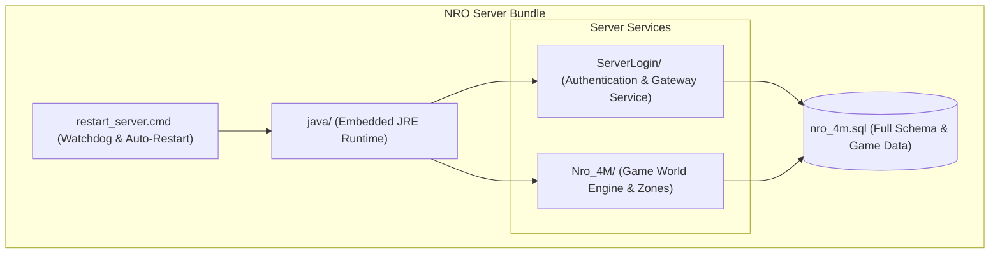

# Ngọc Rồng Online (NRO) — Server Deployment & Runtime Distribution

[](https://www.oracle.com/java/)
[](https://www.mysql.com/)
[](https://en.wikipedia.org/wiki/Batch_file)

> Deployment distribution package, configuration profiles, database migrations, and automated process management scripts for running the **Ngọc Rồng Online (Dragon Boy)** production game server environment.

---

## 1. Directory Overview



---

## 2. Contents & Modules

* **`Nro_4M/`**: The compiled game engine core, containing game configurations, NPC script dialogs, monster spawn definitions, and map asset tables.
* **`ServerLogin/`**: Dedicated authentication microservice handling player login sessions, account verification, and world redirection.
* **`nro_4m.sql`**: Complete relational database schema with tables for player statistics, inventories, skills, clans, transaction logs, and global rankings.
* **`restart_server.cmd`**: Windows batch supervisor script providing auto-restart on crash, automated heap memory allocation, and server health checks.
* **`java/`**: Self-contained Java execution runtime ensuring binary consistency across different host systems without requiring external JDK installations.

---

## 3. Deployment & Running

### Prerequisites
- Windows Server or Windows 10/11 (or Wine/Linux with equivalent shell scripts)
- [MySQL 5.7+ / MariaDB 10.4+](https://www.mysql.com/) installed and running on port 3306

### Setup Instructions

1. **Database Setup**:
   Create a database named `nro_4m` and import the SQL schema:
   ```cmd
   mysql -u root -p nro_4m < nro_4m.sql
   ```

2. **Configuration**:
   Ensure database connection parameters match your MySQL settings in `Nro_4M/config/` and `ServerLogin/config/`.

3. **Start the Servers**:
   Double-click `restart_server.cmd` or execute via Command Prompt:
   ```cmd
   restart_server.cmd
   ```

---

## 4. Author & License

- **Author**: Nguyễn Bảo Toàn ([@btoan2802](https://github.com/btoan2802))
- **Source Code**: [nro-goc](https://github.com/btoan2802/nro-goc)
- **License**: Educational / Proprietary
